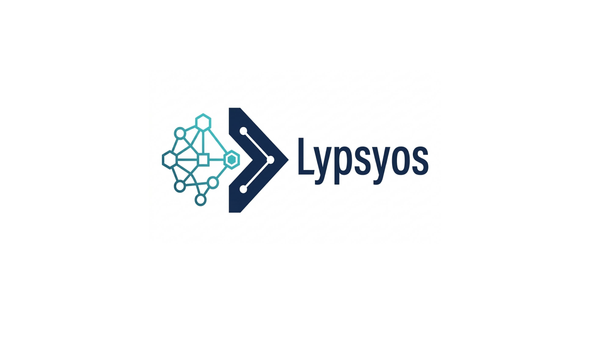
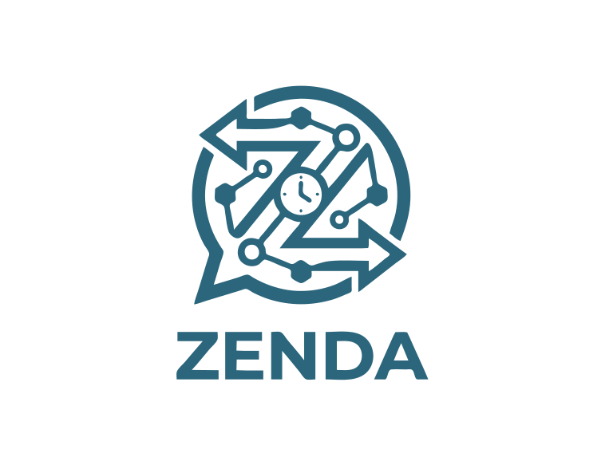

  <h1>Olá! Sou Matheus Ribeiro 🧑‍💻</h1>
  

    <strong>Desenvolvedor Full Stack</strong> • 
    <strong>Engenharia de Software</strong> • 
    <strong>Founder & Lead Dev @ <a href="https://www.lypsyos.com/">Lypsyos</a></strong>
  

  
<em>Construindo sistemas inteligentes, arquiteturas SaaS multitenant e automações de alta velocidade que transformam operações reais.</em>

  
  
  
  

---

### 👨‍💻 Sobre Mim

Sou estudante de **Engenharia de Software** e **Desenvolvedor Full Stack** focado em unir engenharia de back-end robusta (**Python/FastAPI** e **Java/Spring Boot**) com interfaces rápidas, intuitivas e orientadas à experiência do usuário (**React** e **TypeScript**).

Acredito que a boa tecnologia é aquela que elimina gargalos invisíveis do dia a dia. Por isso, além de projetos de engenharia e arquitetura de software, estou à frente da **[Lypsyos](https://www.lypsyos.com/)**, desenvolvendo plataformas digitais em nuvem, sistemas de gestão descomplicados e automações inteligentes de atendimento e agendamento.

- 🚀 **Atualmente focado em:** Arquitetura SaaS Multi-tenant, Microsserviços de Mensageria em Tempo Real (WebSockets), PWAs e Automação Comercial.
- 🏗️ **Especialidades:** Desenvolvimento de APIs RESTful de alta performance, modelagem de bancos de dados relacionais com isolamento de segurança (RLS) e interfaces Mobile-First.
- 💡 **Filosofia de Produto:** Código limpo no back-end, zero burocracia para o usuário final na ponta.

---

### 🚀 Em Destaque: Lypsyos & Ecossistema Zenda

  
  &nbsp;&nbsp;&nbsp;&nbsp;&nbsp;&nbsp;
  

 

A **[Lypsyos](https://www.lypsyos.com/)** é uma iniciativa de tecnologia voltada à criação de sistemas inteligentes, CRMs visuais e automações sob medida para negócios que buscam eliminar tarefas manuais, responder clientes em segundos e ter previsibilidade financeira.

#### ⚡ [Zenda by Lypsyos](https://www.lypsyos.com/) — CRM de Agendamentos & Robô WhatsApp 24/7
Produto oficial desenvolvido para operar como um gerente virtual 24 horas por dia em negócios baseados em agendamento e recorrência:

* 🤖 **Mensageria Inteligente & Robô 24/7:** Microsserviços de alta velocidade com **WebSockets** e URA intuitiva capaz de responder clientes em ~2 segundos e concluir agendamentos em menos de 1 minuto.
* 📊 **Central CRM 3-em-1:** Painel de gestão modular com visualização em **Cartões, Lista Cronológica ou Tabela**, cálculo de faturamento diário em tempo real e motor *Zero Double-Booking* (verificação de conflitos de agenda em milissegundos).
* 📱 **Arquitetura Mobile-First (PWA Nativo):** Aplicação web progressiva instalável com 1 clique no Android ou iOS, equipada com notificações Push proativas e sincronização com Google Calendar.
* 🛡️ **Lypsyos Security Guard:** Infraestrutura em nuvem de alta disponibilidade com isolamento multitenant estrito via **Supabase RLS (Row-Level Security)**, criptografia ponta a ponta e proteção anti-bot.

---

### 🛠️ Minha Stack & Ferramentas

#### Back-end & Arquitetura de Sistemas

  
  
  
  
  

#### Front-end & Mobile (PWA)

  
  
  
  

#### Banco de Dados, Cloud & DevOps

  
  
  
  
  

---

### ⚙️ O Que Eu Construo

| Área de Atuação | Soluções Entregues |
| :--- | :--- |
| **Plataformas SaaS & CRMs** | Sistemas de gestão visual, controle de estoque/ordens de serviço, painéis financeiros em tempo real e ambientes multi-empresa (Multi-tenant). |
| **Automação & Mensageria** | Bots de atendimento e agendamento no WhatsApp, triagem inteligente (URA), alertas automáticos e integrações via Webhook/WebSocket. |
| **APIs & Microsserviços** | Back-ends escaláveis em **FastAPI** e **Spring Boot**, autenticação segura (JWT/OAuth2), geração de relatórios em PDF e integração entre sistemas. |
| **Aplicações Web & PWA** | Interfaces responsivas em **React + TypeScript** desenhadas para uso rápido no balcão ou no celular, sem fricção de aprendizado. |

---

### 📊 Estatísticas e Atividade no GitHub

  
  

---

### 🤝 Vamos Conversar?

Seja para trocar ideias sobre arquitetura de software, discutir oportunidades como Desenvolvedor Full Stack ou conhecer as soluções de automação e sistemas sob medida da **Lypsyos**:

- 🌐 **Portfólio Pessoal:** [matribeiro.tech](https://matribeiro.tech)
- 🚀 **Soluções & Produto Zenda:** [lypsyos.com](https://www.lypsyos.com/)
- 💼 **LinkedIn:** [Matheus Ribeiro](https://www.linkedin.com/in/matheus-ribeiro-bbb894237)
- 📫 **E-mail:** [z1p0l0ck@pm.me](mailto:z1p0l0ck@pm.me)
